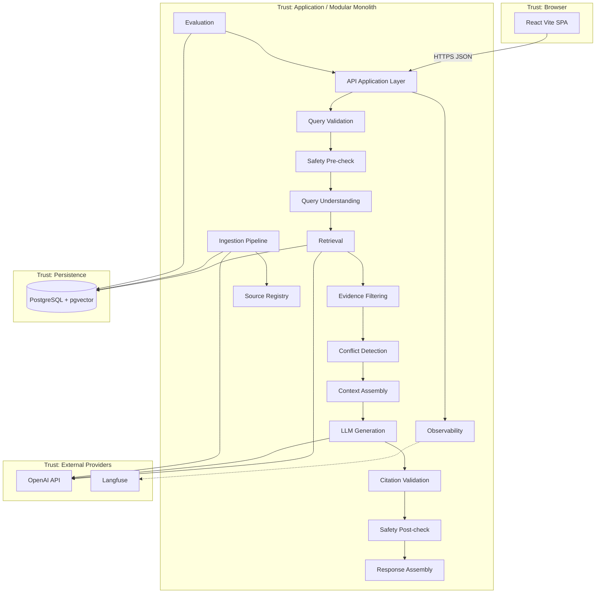
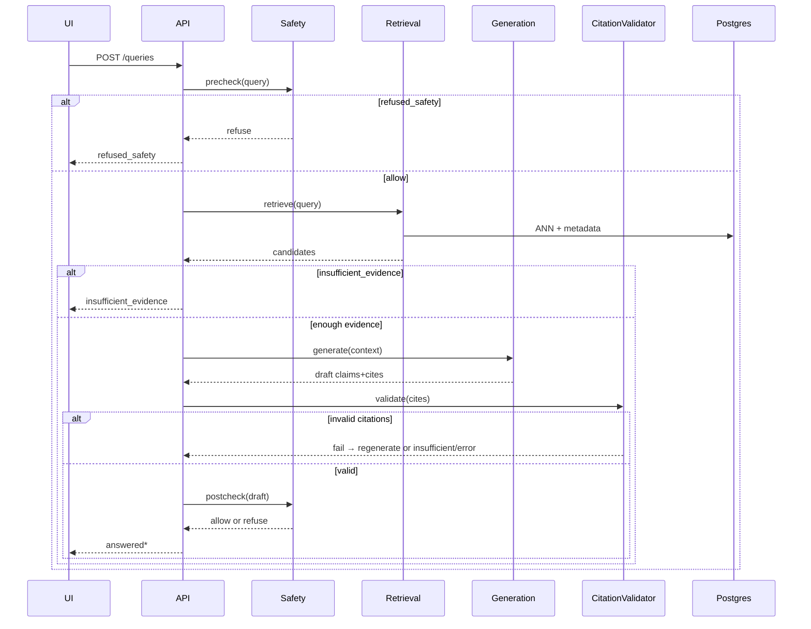
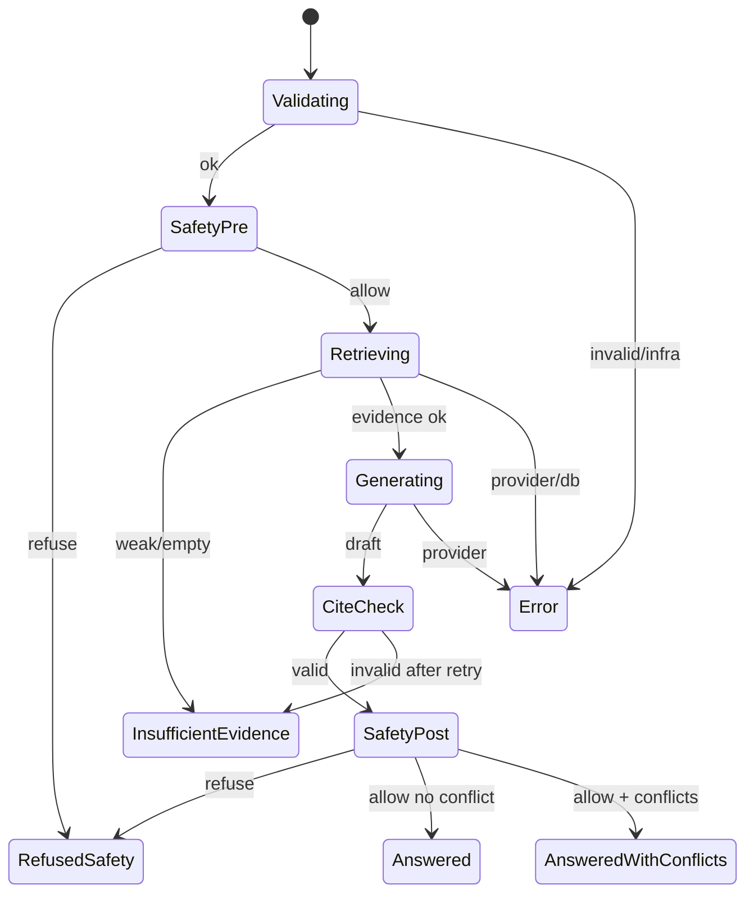
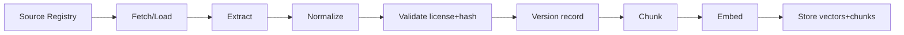
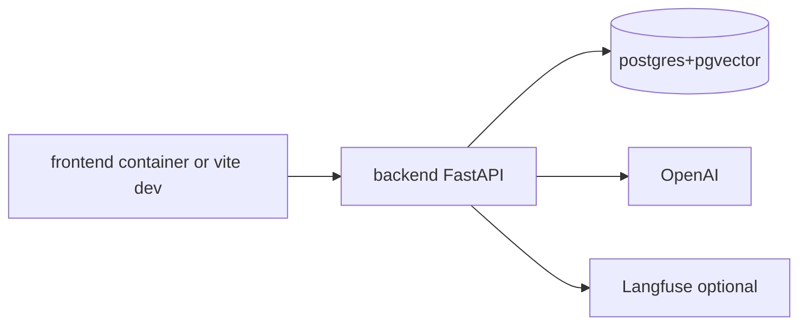

# Architecture — Nutrition Knowledge Assistant

**Status:** Active (Stage 3)  
**Owner:** Agent 02 (Solution Architect)  
**Last updated:** 2026-11-18  
**Depends on:** `docs/PRD.md`, `docs/SAFETY_POLICY.md`, `docs/DECISIONS.md` (D-001…D-007 + D-008+)  
**Companion docs:** `docs/DATA_MODEL.md`, `docs/interfaces/*`, `docs/REQUIREMENTS_TRACEABILITY.md`, `docs/ARCHITECTURE_OPEN_QUESTIONS.md`

---

## 1. System overview

### 1.1 Product scope

Nutrition Knowledge Assistant is an English-language MVP that answers general nutrition questions using a curated, versioned knowledge base. Answers must be evidence-grounded with validated citations, or explicitly return `insufficient_evidence` / `refused_safety` / `error`.

Out of scope for MVP: clinical decision support, user accounts/social features, open-web crawling, multilingual coverage, microservices, message queues.

### 1.2 Architectural principles

1. **Modular monolith** — one FastAPI backend process; clear internal modules; separate Vite SPA.
2. **Transparent RAG** — explicit pipeline stages; no heavyweight agent orchestration framework.
3. **Evidence traceability** — `Source → DocumentVersion → Chunk → RetrievalResult → Evidence → GeneratedClaim → Citation`.
4. **Citation validity hard gate** — invalid citations never ship in `answered*`.
5. **Citation support is eval-time** in MVP — not claimed as runtime semantic verification unless later Decision upgrades it.
6. **Safety dual-gate** — pre-retrieval intent check + post-generation output check.
7. **Retrieved text is untrusted data** — never executable instructions.
8. **Similarity ≠ correctness** — retrieval scores are relevance only.
9. **Fail closed on safety ambiguity; fail explicit on provider errors** — no fake grounded answers.
10. **Config via environment** — no hardcoded secrets.

### 1.3 System boundaries

| Inside MVP system | Outside (integrations) |
|-------------------|------------------------|
| FastAPI app (API + domain modules) | OpenAI Embeddings + Chat Completions |
| React/Vite UI | Langfuse (optional; mock if unset) |
| PostgreSQL + pgvector | Operator workstation (CLI/scripts for ingest) |
| Evaluation runners (pytest/scripts) | Human-approved source files under `data/` |

### 1.4 External dependencies

- OpenAI API (embeddings + generation) — D-003
- PostgreSQL + pgvector — D-002
- Langfuse — D-006 (graceful degrade)
- Docker Compose — D-007

### 1.5 Main assumptions

- Single-operator local/demo deployment for MVP.
- Operator ingest via authenticated-or-localhost-restricted admin API and/or CLI (see D-014).
- Initial KB is manually curated; licensing cleared by Agent 03 (fixtures allowed if labeled).
- English queries and UI only (PRD §7).
- Provisional embedding/generation model IDs until cost/quality eval (see open questions).

---

## 2. High-level architecture

### 2.1 Component diagram



### 2.2 Responsibilities (summary)

| Component | Responsibility |
|-----------|----------------|
| API Layer | HTTP adapters, auth gates, DTO validation, status mapping |
| Query Validation | Schema, length, language expectation, injection-sanitized intake |
| Safety Pre-check | Intent classification vs Safety Policy categories |
| Query Understanding | Normalize query; detect compare-authorities intent; extract soft facets |
| Retrieval | Embed query; ANN search; return scored candidates |
| Evidence Filtering | Drop deactivated/low-signal; apply metadata filters; outdated tagging |
| Conflict Detection | Detect multi-authority disagreements for disclosure |
| Context Assembly | Build untrusted evidence pack for the LLM |
| LLM Generation | Produce claim-structured draft constrained to evidence |
| Citation Validation | Hard-gate: every citation resolves to chunk + document_version |
| Safety Post-check | Scan output for policy violations / injection compliance |
| Response Assembly | Map to public response + disclaimer + conflicts |
| Source Registry | Approved sources metadata, license, provenance |
| Ingestion | Fetch→extract→normalize→version→chunk→embed→store |
| Evaluation | Offline/online checks for quality dimensions |
| Observability | Traces, latency, tokens, cost, decision logs |

### 2.3 Communication paths

- **UI ↔ API:** versioned REST JSON (`/api/v1/...`).
- **Modules ↔ modules:** in-process Python calls via interfaces in `docs/interfaces/`.
- **App ↔ DB:** SQLAlchemy async or sync (implementation choice; prefer sync for MVP simplicity unless load requires async — provisional D-008 note).
- **App ↔ OpenAI / Langfuse:** HTTPS outbound only from backend.

### 2.4 Trust boundaries

1. **Browser** — untrusted input; never receives secrets.
2. **API edge** — validates/sanitizes; rate-limits if exposed.
3. **Domain pipeline** — safety cannot be disabled by user or chunk text.
4. **KB content** — untrusted *data*; trusted only as *registered provenance objects*, not as instructions.
5. **Providers** — trusted for transport; untrusted for medical truth; failures → `error`.

### 2.5 Ask-path data flow



---

## 3. Component architecture

**Packaging rule:** All backend components below are **modules inside one FastAPI application** unless noted. Frontend is a separate Vite app. Evaluation may run as CLI against the same packages.

Proposed layout (D-008):

```
nutrition-knowledge-assistant/
  backend/
    app/
      api/           # HTTP routes
      core/          # config, logging, errors
      modules/
        safety/
        query/
        retrieval/
        evidence/
        generation/
        citations/
        ingestion/
        sources/
        evaluation/
      adapters/      # openai, langfuse, db
  frontend/
  evaluation/        # datasets + runners (Agent 10)
  docs/
```

### 3.1 Component catalog

For each: MVP = Must/Should in MVP unless marked Later.

#### API / Application Layer — **MVP**

- **Responsibility:** REST endpoints; map domain results to Query Response; error sanitization.
- **Inputs:** HTTP requests.
- **Outputs:** JSON responses (`answered*`, `insufficient_evidence`, `refused_safety`, `error`).
- **Dependencies:** all domain modules; Observability.
- **Failure modes:** validation 4xx; unhandled → sanitized 500/`error`.
- **FR/AC:** FR-001, FR-020–024, FR-022; AC-01, AC-09, AC-40–42, AC-51.

#### Query Validation — **MVP**

- **Responsibility:** Enforce request schema, max length, non-empty text, English MVP expectation (soft: do not hard-fail non-English if detectable — return clear unsupported message if implemented; else process best-effort and rely on retrieval miss).
- **Inputs:** raw query DTO.
- **Outputs:** `ValidatedQuery` or validation error.
- **Dependencies:** none.
- **Failure modes:** invalid payload → 422.
- **FR/AC:** FR-001; AC-42.

#### Safety Pre-check — **MVP**

- **Responsibility:** Classify intent into Safety Policy categories; decide `allow` | `refuse` | `allow_with_heightened_disclaimer`; never skippable via prompt text.
- **Inputs:** validated query text (+ optional lightweight heuristics features).
- **Outputs:** `SafetyDecision` (phase=`pre`).
- **Dependencies:** Safety Policy rules engine (rules + optional LLM assist — rules-first for determinism).
- **Failure modes:** component error → **fail closed** to `refused_safety` with generic safe message OR `error` if infra broken (prefer `error` for total crash; prefer refuse on ambiguous classification — see §5).
- **FR/AC:** FR-002, FR-008, FR-033–034; AC-20–30, AC-25.

#### Query Understanding — **MVP (minimal)**

- **Responsibility:** Normalize whitespace; detect compare-authorities intent; optional authority mentions (WHO, USDA); detect question type `factual|compare|definition`.
- **Inputs:** validated query + safety allow.
- **Outputs:** `QueryPlan` (facets, requested_authorities[]).
- **Dependencies:** none (no LLM required in MVP).
- **Failure modes:** degrade to empty facets.
- **FR/AC:** FR-015; AC-11; scenarios S03.

#### Retrieval — **MVP**

- **Responsibility:** Embed query; top-k ANN over active chunks; return `RetrievalResult[]` with relevance scores.
- **Inputs:** `QueryPlan`.
- **Outputs:** ranked candidates with `chunk_id`, `document_version_id`, `relevance_score`, metadata.
- **Dependencies:** Embeddings adapter, Vector Storage.
- **Failure modes:** embed API fail → `error`; DB fail → `error`.
- **FR/AC:** FR-003, FR-019, FR-029; AC-12.

#### Evidence Filtering — **MVP**

- **Responsibility:** Exclude deactivated versions; attach outdated flags; optional authority filter when compare requested; drop near-zero relevance by **configurable** threshold (provisional).
- **Inputs:** retrieval candidates + QueryPlan.
- **Outputs:** `Evidence[]` candidates.
- **Dependencies:** Document metadata.
- **Failure modes:** over-filter → insufficient_evidence (acceptable).
- **FR/AC:** FR-007, FR-026, FR-031; AC-08, AC-43.

#### Conflict Detection — **MVP**

- **Responsibility:** If ≥2 authorities present with divergent recommendation cues (heuristic: opposing stance labels from metadata or structured “stance” tags when available; MVP heuristic + generation disclosure instruction), mark `conflicts_detected`.
- **Inputs:** filtered evidence.
- **Outputs:** conflict report (authority pairs, evidence ids).
- **Dependencies:** Evidence metadata (`authority`, optional `topic_key`).
- **Failure modes:** false negatives → mitigated by generation instruction to separate authorities; false positives → extra disclosure (acceptable).
- **FR/AC:** FR-014; AC-10; S05.

#### Context Assembly — **MVP**

- **Responsibility:** Build prompt context: system rules + **data-delimited** evidence blocks (chunk text clearly marked as DATA); include version/outdated flags; never concatenate as instructions.
- **Inputs:** evidence + conflict report + safety flags.
- **Outputs:** `GenerationContext`.
- **Dependencies:** none.
- **Failure modes:** empty context → insufficient_evidence before LLM call.
- **FR/AC:** FR-004, FR-010, FR-013; AC-30.

#### LLM Generation — **MVP**

- **Responsibility:** Produce structured draft: answer prose + `GeneratedClaim[]` each with citation chunk ids drawn **only** from provided evidence ids; may emit `insufficient_evidence` recommendation if evidence weak.
- **Inputs:** `GenerationContext`.
- **Outputs:** draft payload.
- **Dependencies:** OpenAI chat.
- **Failure modes:** timeout/5xx → `error` (FR-023; AC-41).
- **FR/AC:** FR-004, FR-005, FR-009–010; AC-02, AC-07.

#### Citation Validation — **MVP**

- **Responsibility:** **Hard gate** — every cited `chunk_id` exists, belongs to claimed `document_version_id`, is in the evidence set for this request; strip/reject invented ids.
- **Inputs:** draft claims + evidence set + DB.
- **Outputs:** validated claims/citations or validation failure.
- **Dependencies:** persistence.
- **Failure modes:** invalid cites → one controlled regenerate with stricter prompt; if still invalid → `insufficient_evidence` or `error` (prefer `insufficient_evidence` if intent was OK but grounding failed).
- **FR/AC:** FR-006, FR-009; AC-05, AC-06.

#### Safety Post-check — **MVP**

- **Responsibility:** Scan draft for diagnosis/treatment/dosing/ED/extreme loss/emergency mismanagement; ensure disclaimer flag; block injection-compliant persona claims.
- **Inputs:** draft answer text + claims + predecision categories.
- **Outputs:** `SafetyDecision` (phase=`post`) allow|refuse.
- **Dependencies:** rules (+ optional LLM judge — eval-assisted; MVP rules-first).
- **Failure modes:** ambiguous → **refuse** (`refused_safety`); crash → `error`.
- **FR/AC:** FR-008, FR-033; AC-20–30.

#### Response Assembly — **MVP**

- **Responsibility:** Choose terminal status; attach disclaimer; map citations to public objects; include conflict section; label scores as relevance if exposed.
- **Inputs:** validated draft + safety decisions + evidence.
- **Outputs:** `QueryResponse`.
- **Dependencies:** none.
- **Failure modes:** none if inputs valid.
- **FR/AC:** FR-011, FR-020–021, FR-014–015; AC-01–04, AC-09–11.

#### Source Registry — **MVP**

- **Responsibility:** Register approved sources with license, canonical URL, authority, jurisdiction.
- **Inputs:** operator registration.
- **Outputs:** `Source` records.
- **Dependencies:** DB.
- **Failure modes:** reject unlicensed/unknown.
- **FR/AC:** FR-016–017; AC-44; Agent 03.

#### Document Ingestion / Versioning / Chunking / Embeddings / Vector Storage — **MVP**

- See §8. Modules: `ingestion`, `sources`, adapters.
- **FR/AC:** FR-016–019, FR-031; AC-43–44.

#### Evaluation — **MVP (baseline)**

- Offline runners over fixtures; deterministic citation validity; scenario outcome checks; optional LLM-as-judge for support/groundedness (explicitly labeled).
- **FR/AC:** FR-030 related; AC-53.

#### Observability — **MVP**

- Structured logs + Langfuse spans; mock no-op if unset.
- **FR/AC:** FR-030; AC-52.

#### Component contract matrix

The following matrix makes the boundary explicit for every required architectural component. Components remain modules in the modular monolith; a row is not a separate service.

| Component | Inputs → outputs | Dependencies | Failure mode / terminal behavior | FR / AC | Phase |
|---|---|---|---|---|---|
| API / Application Layer | HTTP DTO → sanitized HTTP response | All domain modules, observability | 4xx for validation; sanitized `error` for unexpected failures | FR-001, FR-020–024; AC-01, AC-09, AC-40–42, AC-51 | MVP |
| Query Validation | raw request → `ValidatedQuery` | None | Invalid/oversized/empty payload → 422 | FR-001; AC-42 | MVP |
| Safety Pre-check | validated query → pre `SafetyDecision` | Safety Policy, rules engine | Ambiguous → `refused_safety`; unavailable/crash → `error`; never bypass | FR-002, FR-008, FR-033–034; AC-20–30 | MVP |
| Query Understanding | validated safe query → `QueryPlan` | None; deterministic parsing preferred | Parse failure → empty facets; continue with safe baseline | FR-015; AC-11 | MVP |
| Retrieval | `QueryPlan` → ranked `RetrievalHit[]` | OpenAI embeddings, PostgreSQL/pgvector | Provider/DB failure → `error`; empty result is normal | FR-003, FR-019, FR-029; AC-08, AC-12 | MVP |
| Evidence Filtering | hits + plan → `EvidenceBuildResponse` | Document metadata, configurable provisional gate | Filtered empty set → `insufficient_evidence` | FR-007, FR-026, FR-031; AC-08, AC-43 | MVP |
| Conflict Detection | selected evidence → `ConflictReport` | Authority/topic/stance metadata | Heuristic miss → generation still separates authorities; false positive → disclosure | FR-014; AC-10 | MVP |
| Context Assembly | evidence + conflict + safety flags → `GenerationContext` | Evidence contract | Empty context → `insufficient_evidence`; chunk text stays DATA | FR-004, FR-010, FR-013; AC-30 | MVP |
| LLM Generation | generation context → structured draft claims | OpenAI chat adapter | Timeout/provider error → `error`; model abstention → `insufficient_evidence` | FR-004–005, FR-009–010, FR-023; AC-02, AC-07, AC-41 | MVP |
| Citation Validation | draft + evidence + DB → validated claims/citations | Chunk/version repository | Invalid IDs: one retry, then `insufficient_evidence`; DB failure → `error` | FR-005–006, FR-009; AC-02, AC-05–06 | MVP |
| Safety Post-check | draft + claims → post `SafetyDecision` | Safety rules, pre-decision context | Violation/ambiguity → discard draft, `refused_safety`; crash → `error` | FR-008, FR-033; AC-20–30 | MVP |
| Response Assembly | validated draft + decisions → `QueryResponse` | Public DTO schemas | Invalid internal state is an application error, never a partial success | FR-011, FR-014–015, FR-020–021; AC-01–04, AC-09–11 | MVP |
| Source Registry | operator source metadata → `Source` | PostgreSQL, licensing metadata | Unknown/forbidden license → reject ingest | FR-016–017; AC-44 | MVP |
| Document Ingestion | approved input → `IngestionJob` / version | Source registry, extractors, DB, embeddings | Stage failure recorded; no half-active version | FR-017–019, FR-026, FR-031; AC-43–44 | MVP |
| Document Versioning | normalized content → immutable `DocumentVersion` | Document/source records, hashes | Duplicate hash is idempotent; conflicting label is explicit error | FR-016, FR-026, FR-031; AC-43 | MVP |
| Chunking | version text → ordered `Chunk[]` | Provisional D-010 config | Parse/chunk failure fails job; old version remains active | FR-018; AC-44 | MVP |
| Embeddings | chunk text → model-tagged vectors | OpenAI embedding adapter | Provider failure fails ingestion/retrieval with `error` | FR-019, FR-023; AC-41, AC-44 | MVP |
| Vector Storage | vectors + metadata → persistent searchable index | PostgreSQL/pgvector | DB unavailable → `error`; no silent empty success | FR-018–019, NFR-R2 | MVP |
| Evaluation | dataset + run config → results/report | Query contract, persisted traces | Judge failure is `passed=null`, never fabricated pass | FR-030; AC-53 | MVP baseline |
| Observability | lifecycle events → structured logs/traces/metrics | Langfuse optional adapter | Missing credentials → no-op/mock; never crash request | FR-030; AC-52 | MVP |

The detailed module contracts in `docs/interfaces/` define the exact fields and examples for these inputs and outputs.

---

#### Feedback — **Should / Later-OK in same API**

- Persist `FeedbackEvent` linked to `query_id`.
- **FR/AC:** FR-027; AC-45.

---

## 4. Runtime workflows

Terminal outcomes (exact names):  
`answered` | `answered_with_conflicts` | `insufficient_evidence` | `refused_safety` | `error`

### 4.1 Normal grounded question (S01)

1. Validate → Safety pre (`allow`) → Understand → Retrieve → Filter → Conflicts(no) → Context → Generate → Cite validate → Safety post (`allow`) → Assemble `answered`.

### 4.2 Multi-source question (S02)

Same as 4.1; evidence from ≥2 chunks/docs; multiple citations required when multiple claims/sources used.

### 4.3 Conflicting recommendations (S05)

After filter, Conflict Detection marks conflicts → Generate instructed to separate sides → Assemble `answered_with_conflicts` with `conflicts[]`.

### 4.4 Insufficient evidence (S04)

If after filter evidence set empty/below provisional bar, **skip generation**, return `insufficient_evidence`.  
Also reachable if generation abstains or citation validation repeatedly fails without safe grounded content.

### 4.5 Safety refusal (S06, S08, S12)

Safety pre returns refuse → Assemble `refused_safety` (category, safe message, emergency redirect if Cat 13). No retrieval required (may still log). Post-check can also refuse after generation → discard draft → `refused_safety`.

### 4.6 Prompt injection in retrieved content (S11)

Context Assembly wraps chunk as DATA. Generation system prompt forbids following chunk instructions. Safety post rejects physician-persona / prescribe patterns. Citation gate still applies. Outcome: `answered*` if educational content possible, else `refused_safety` / `insufficient_evidence` — never secret leak.

### 4.7 LLM provider failure (S10)

Generation or embedding throws → `error` sanitized; no fake answer.

### 4.8 Citation validation failure

Invalid chunk ids → one retry with corrected instruction listing allowed ids only → if still invalid → `insufficient_evidence` (preferred) or `error` if validator/DB broken.



---

## 5. Safety architecture

### 5.1 Enforcement points

| Point | When | Action |
|-------|------|--------|
| Pre-check | After validation, before retrieval | Block L2/L3 harmful intents early |
| Context isolation | Before LLM | Chunks as untrusted DATA |
| Post-check | After cite validation | Catch leakage of clinical advice / injection |
| API sanitization | Always | No secrets in errors |

**Decision (D-012):** Both pre and post checks are mandatory for MVP.

### 5.2 Category handling (maps to SAFETY_POLICY)

| Cat | Pre-check | Post-check focus |
|-----|-----------|------------------|
| 1–3 General/science/guidelines | Allow | Ensure no personalization creep |
| 4 Personalized | Refuse strong personalization | Strip personal plans |
| 5 Disease-specific | Refuse treatment/diagnosis; allow narrow guideline education only when clearly general | Block diagnostic language |
| 6 Supplements | Refuse personal dosing; allow educational | Block dose regimens |
| 7 Medications | Refuse | Block interaction/dosing advice |
| 8 ED | Refuse harmful coaching | Block restriction coaching |
| 9 Extreme weight loss | Refuse protocols | Block crash-diet instructions |
| 10–11 Pregnancy/children | Allow general guidelines + heightened disclaimer; refuse personal clinical | Same |
| 12 Insufficient evidence | N/A (process outcome) | N/A |
| 13 Emergency | Refuse + emergency redirect | Ensure redirect present; no treatment protocol |

### 5.3 Ambiguity & unavailability

| Situation | Policy |
|-----------|--------|
| Classifier confidence ambiguous between allow and refuse | **Fail closed:** `refused_safety` with safe generic message (prefer under-answer to over-advice). Exception: pure Cat 1–3 lexical matches with no personalization markers may allow (FR-034). |
| Safety module exception/crash | `error` (do not bypass to generation) |
| Post-check ambiguous | `refused_safety` |
| Pre-check refuse | Do not call generation |

### 5.4 Vulnerable users

Heightened disclaimer flag on pregnancy/children educational allows; never personal clinical plans. ED/extreme loss: refuse actionable content; compassionate redirect; no detailed harmful guidance.

---

## 6. Evidence and citation architecture

### 6.1 Trace chain

```
Source (stable source_id)
  └─ Document (document_id, logical work)
       └─ DocumentVersion (document_version_id, version_label, content_hash, is_outdated, is_active)
            └─ Chunk (chunk_id, ordinal, text, content_hash)
                 └─ Embedding (chunk_id, model_id, vector)
                      └─ RetrievalResult (query_id, chunk_id, relevance_score)
                           └─ Evidence (selected subset + flags)
                                └─ GeneratedClaim (claim_id, text)
                                     └─ Citation (claim_id, chunk_id, document_version_id)  [validity gated]
```

### 6.2 Identifiers

- UUIDs for all persistent ids (`source_id`, `document_id`, `document_version_id`, `chunk_id`, `query_id`, …).
- `content_hash` = SHA-256 of normalized bytes/text for idempotent ingest.
- Canonical `source_url` / `version_url` stored on Source/DocumentVersion.
- Citations in API must include `chunk_id` + `document_version_id` + enough metadata for UI.

### 6.3 Validity vs support

| Concept | MVP enforcement |
|---------|-----------------|
| **Citation validity** | Runtime hard gate (DB + evidence-set membership) |
| **Citation support** | Evaluation suite (Agent 10); optional heuristic logging only — **not** user-facing “verified entailment” |

### 6.4 Outdated / superseded / deactivated

- `is_outdated=true` → allowed in retrieval by default but **must disclose** when cited (FR-026/AC-43).
- `is_active=false` → excluded from default retrieval; rows retained for audit (FR-031 Could).
- Hard delete of versions **disallowed** if citations may exist; prefer deactivate.

### 6.5 Conflicts & missing authorities

- Conflicts → `answered_with_conflicts` + structured `conflicts[]` (D-013: separate status, not only flag).
- Missing requested authority → `coverage.missing_authorities[]` disclosure (FR-015).

### 6.6 Similarity

`relevance_score` is opaque float for ranking; API field `score_type: "retrieval_relevance"`.

---

## 7. Retrieval and insufficient evidence

### 7.1 Pipeline

1. **Query preparation** — normalize text; attach QueryPlan facets.
2. **Embedding** — OpenAI embedding model (provisional id in config).
3. **Candidate retrieval** — pgvector top_k (default 12, config).
4. **Metadata filtering** — active only; optional authority filter.
5. **Ranking** — distance/similarity order; optional small boost for non-outdated (config).
6. **Evidence selection** — take top_n (default 6) after filters.
7. **Context assembly** — truncate per-chunk and total token budget (config).

### 7.2 Insufficient evidence policy (provisional — D-015)

Do **not** treat similarity as calibrated probability.

MVP rule (config-driven, calibrated later by eval):

- If `selected_evidence_count == 0` → `insufficient_evidence`.
- If max `relevance_score` < `RETRIEVAL_MIN_SCORE` (default **unset / 0.0** initially; enable only after Agent 10 calibration) → optional gate.
- If generation returns abstain / cannot cite → `insufficient_evidence`.

**Until calibrated, prefer empty-set and citation-failure paths over aggressive score cutoffs** to avoid silent over-refusal of valid content.

### 7.3 Multi-jurisdiction / populations

Metadata fields `authority`, `jurisdiction`, `population_tags` on DocumentVersion; Query Understanding may request authorities; Conflict Detection uses authority differences. No automatic “pick winner.”

---

## 8. Document ingestion architecture



### 8.1 Properties

| Concern | Approach |
|---------|----------|
| Idempotency | Unique `(document_id, content_hash)` or `(document_id, version_label)`; re-run no-ops if hash unchanged |
| Retry | Per-stage retries for OpenAI embed; mark `IngestionJob.status=failed` with stage |
| Partial failure | Transaction per version: chunks+embeddings commit together; failed job leaves prior active version intact |
| Duplicates | content_hash match → skip |
| Version replacement | New version row; optionally deactivate previous; do not rewrite old chunk ids |
| Deactivation | `is_active=false` |
| Provenance | source_id, urls, retrieved_at, license_spdx, license_notes |
| Manual review | `approval_status` on source/version: `approved` required before retrieval eligibility |

**License:** Public accessibility ≠ processing rights. Agent 03 must set license metadata; ingest rejects `license_status != approved_for_kb`.

---

## 9. Data architecture

See **`docs/DATA_MODEL.md`** for entities, ER diagram, retention.

Persistent: Source, Document, DocumentVersion, Chunk, Embedding, IngestionJob, Query, SafetyDecision, Citation snapshot fields on QueryResponse log, Feedback, EvaluationRun/Result, AuditEvent.  
Ephemeral: RetrievalResult, Evidence pack, GenerationContext (may be persisted partially for audit/trace).

---

## 10. API and integration architecture

Base path: `/api/v1`.

| Endpoint (conceptual) | Method | Purpose |
|-----------------------|--------|---------|
| `/queries` | POST | Ask question |
| `/queries/{query_id}` | GET | Fetch stored query result (optional MVP) |
| `/chunks/{chunk_id}` | GET | Citation inspection |
| `/documents` | GET | Operator list (Should) |
| `/ingestion/jobs` | POST/GET | Operator ingest |
| `/feedback` | POST | Helpful/not (Should) |
| `/health` | GET | Liveness |

Contracts: `docs/interfaces/*.md`.

- **Versioning:** URI `/api/v1`; breaking changes bump version.
- **Auth:** public query endpoints for local demo; operator endpoints require `OPERATOR_API_TOKEN` header (D-014).
- **Rate limit:** optional middleware; default enabled with generous local limits when tokenless demo (open question).
- **Timeouts:** embed/generate timeouts config → `error`.
- **Idempotency:** ingest by content_hash; queries normally non-idempotent (new query_id each POST).

---

## 11. Frontend integration

Minimum views/states:

1. Question input + submit  
2. Loading  
3. Status badge: five outcomes  
4. Answer body + disclaimer  
5. Citation list → inspect drawer/panel (chunk excerpt, source, version, outdated)  
6. Conflicts panel when `answered_with_conflicts`  
7. Insufficient-evidence empty-evidence message  
8. Safety refusal message (+ emergency CTA if present)  
9. Error message (sanitized)

Frontend depends **only** on QUERY + chunk GET contracts; no direct DB/OpenAI access.

---

## 12. Evaluation architecture

| Dimension | Method | Deterministic? |
|-----------|--------|----------------|
| Citation validity | DB resolve + evidence membership | Yes |
| Outcome correctness | Scenario expected status | Yes |
| Safety refusal/allow | Policy fixture cases | Mostly yes (rules) |
| Retrieval relevance | Labeled chunk ids / Recall@k | Yes (labels) |
| Groundedness / citation support | Human or LLM-judge rubric | LLM-assist optional |
| Conflict handling | Fixture S05 | Yes |
| Version regression | Re-run eval after ingest | Yes |

Artifacts: `evaluation/datasets/*`, `EvaluationRun`, `EvaluationResult`, reports under `evaluation/results/` (gitignored content).

---

## 13. Observability and operations

- **Langfuse:** span per query; children: safety_pre, retrieve, generate, cite_validate, safety_post; attributes: status, token usage, latency_ms, estimated_cost, model ids, safety categories.
- **Logs:** structured JSON; `request_id`/`query_id`; never log API keys, raw `.env`, or unnecessary PII/health narratives beyond needed debug in dev.
- **Metrics:** counters for each terminal status; citation validation failures; ingest failures.

Mock tracer if `LANGFUSE_PUBLIC_KEY` unset (AC-52).

---

## 14. Deployment architecture



| Env | Purpose |
|-----|---------|
| development | Compose: api, db, optional langfuse; Vite dev server |
| test | pytest + testcontainers or Compose test profile |
| production-like local | Compose prod profile; built frontend; no debug leak |

**Conceptual secrets:** `OPENAI_API_KEY`, `DATABASE_URL`, `OPERATOR_API_TOKEN`, `LANGFUSE_*`, model name envs (`EMBEDDING_MODEL`, `CHAT_MODEL`).

---

## 15. Cross-references

- Decisions: `docs/DECISIONS.md` D-008+  
- Open questions: `docs/ARCHITECTURE_OPEN_QUESTIONS.md`  
- Traceability: `docs/REQUIREMENTS_TRACEABILITY.md`  
- Interfaces: `docs/interfaces/`  
- Data model: `docs/DATA_MODEL.md`
