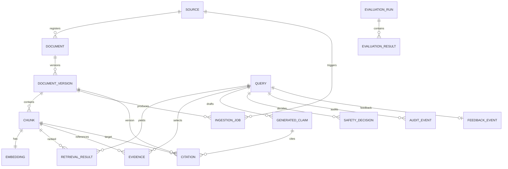

# Data Model — Nutrition Knowledge Assistant

**Status:** Active (Stage 3)
**Owner:** Agent 02
**Last updated:** 2026-11-18
**Note:** Conceptual model only. No SQL migrations or ORM code in this stage.

---

## 1. ER overview

---

## 2. Entity catalog

### 2.1 Source

| Field | Notes |
|-------|-------|
| **PK** | `source_id` (UUID) |
| Attributes | `name`, `authority` (e.g., WHO, USDA, other), `jurisdiction`, `canonical_url`, `license_spdx`, `license_status` (`approved_for_kb`\|`forbidden`\|`unknown`), `license_notes`, `created_at` |
| Relationships | 1→N Document |
| Uniqueness | `canonical_url` unique when present |
| Lifecycle | Created by operator/Agent 03 catalog; rarely deleted |
| Versioning | Source is stable; content versions live under DocumentVersion |
| Persistence | Persistent |
| Sensitivity | Public metadata |

### 2.2 Document

| Field | Notes |
|-------|-------|
| **PK** | `document_id` (UUID) |
| Attributes | `source_id`, `title`, `doc_type` (`guideline`\|`publication`\|`fixture`), `language` (default `en`), `created_at` |
| Relationships | N←1 Source; 1→N DocumentVersion |
| Uniqueness | (`source_id`, `title`) soft-unique recommended |
| Lifecycle | Logical work identity across versions |
| Persistence | Persistent |

### 2.3 DocumentVersion

| Field | Notes |
|-------|-------|
| **PK** | `document_version_id` (UUID) |
| Attributes | `document_id`, `version_label`, `published_at` (nullable), `retrieved_at`, `version_url`, `content_hash`, `is_outdated`, `is_active`, `approval_status` (`approved`\|`pending`\|`rejected`), `population_tags` (JSON array), `raw_uri` (path in `data/`), `created_at` |
| Relationships | N←1 Document; 1→N Chunk |
| Uniqueness | (`document_id`, `content_hash`) unique; (`document_id`, `version_label`) unique |
| Lifecycle | Immutable bytes after approve; deactivate instead of mutate |
| Versioning | Core versioning entity |
| Persistence | Persistent |
| Retention | Keep for audit even if inactive |

### 2.4 Chunk

| Field | Notes |
|-------|-------|
| **PK** | `chunk_id` (UUID) |
| Attributes | `document_version_id`, `ordinal`, `text`, `token_count`, `content_hash`, `char_start`, `char_end` (optional) |
| Relationships | N←1 DocumentVersion; 1→1 Embedding |
| Uniqueness | (`document_version_id`, `ordinal`) unique; (`document_version_id`, `content_hash`) unique |
| Lifecycle | Immutable with version |
| Persistence | Persistent |

### 2.5 Embedding

| Field | Notes |
|-------|-------|
| **PK** | `chunk_id` (UUID, FK) |
| Attributes | `model_id`, `dimensions`, `vector` (pgvector), `created_at` |
| Uniqueness | One embedding per chunk per model in MVP (PK chunk_id); multi-model later needs composite key |
| Persistence | Persistent |
| Sensitivity | Non-secret |

### 2.6 IngestionJob

| Field | Notes |
|-------|-------|
| **PK** | `ingestion_job_id` (UUID) |
| Attributes | `source_id`, `document_version_id` (nullable until created), `status` (`queued`\|`running`\|`succeeded`\|`failed`), `stage`, `error_code`, `error_message_safe`, `created_at`, `finished_at` |
| Lifecycle | Append-only history |
| Persistence | Persistent |

### 2.7 Query

| Field | Notes |
|-------|-------|
| **PK** | `query_id` (UUID) |
| Attributes | `request_id`, `question_text`, `language`, `status` (terminal outcome enum), `disclaimer_shown`, `heightened_disclaimer`, `coverage_json`, `conflicts_json`, `answer_text`, `model_ids_json`, `latency_ms`, `token_usage_json`, `created_at` |
| Relationships | SafetyDecision, RetrievalResult, Evidence, GeneratedClaim, Feedback |
| Persistence | Persistent (demo retention; see open questions) |
| Sensitivity | May contain health-related free text — treat as sensitive; minimize retention in shared envs |

### 2.8 RetrievalResult

| Field | Notes |
|-------|-------|
| **PK** | (`query_id`, `chunk_id`) |
| Attributes | `relevance_score`, `rank`, `score_type`=`retrieval_relevance` |
| Persistence | Persistent recommended for audit/eval; may be ephemeral if cost dictates (prefer persist MVP) |

### 2.9 Evidence

| Field | Notes |
|-------|-------|
| **PK** | (`query_id`, `chunk_id`) |
| Attributes | `selected`, `outdated_disclosed`, `authority`, `notes` |
| Meaning | Subset of retrieval selected for context |
| Persistence | Persistent for audit |

### 2.10 GeneratedClaim

| Field | Notes |
|-------|-------|
| **PK** | `claim_id` (UUID) |
| Attributes | `query_id`, `ordinal`, `claim_text`, `validation_status` (`valid`\|`rejected`) |
| Persistence | Persistent |

### 2.11 Citation

| Field | Notes |
|-------|-------|
| **PK** | `citation_id` (UUID) |
| Attributes | `claim_id`, `chunk_id`, `document_version_id`, `validity_passed` (bool) |
| Constraints | FK chunk + version must exist; version must own chunk |
| Persistence | Persistent |
| Note | Support score **not** stored as truth; optional eval-only fields elsewhere |

### 2.12 EvaluationRun / EvaluationResult

| Entity | PK | Attributes |
|--------|-----|------------|
| EvaluationRun | `evaluation_run_id` | `suite_name`, `started_at`, `finished_at`, `git_sha`, `config_json` |
| EvaluationResult | `evaluation_result_id` | `evaluation_run_id`, `case_id`, `metric_name`, `metric_value`, `passed`, `details_json` |

Persistent; reports may also be files under `evaluation/results/`.

### 2.13 SafetyDecision

| Field | Notes |
|-------|-------|
| **PK** | `safety_decision_id` (UUID) |
| Attributes | `query_id`, `phase` (`pre`\|`post`), `categories` (JSON), `risk_level`, `decision` (`allow`\|`refuse`\|`allow_with_heightened_disclaimer`), `rationale_code`, `message_key`, `created_at` |
| Persistence | Persistent |
| Sensitivity | Rationale codes preferred over storing full user text duplicates |

### 2.14 AuditEvent

| Field | Notes |
|-------|-------|
| **PK** | `audit_event_id` (UUID) |
| Attributes | `query_id` (nullable), `ingestion_job_id` (nullable), `event_type`, `payload_json` (sanitized), `created_at` |
| Persistence | Persistent |
| Must not contain | API keys, raw credentials |

### 2.15 FeedbackEvent (Should)

| Field | Notes |
|-------|-------|
| **PK** | `feedback_id` (UUID) |
| Attributes | `query_id`, `rating` (`helpful`\|`not_helpful`), `reason_code` (optional), `created_at` |
| Persistence | Persistent |

---

## 3. Cross-cutting constraints

1. Chunk always belongs to exactly one DocumentVersion.
2. Citation validity requires Chunk.document_version_id == Citation.document_version_id.
3. Only `approval_status=approved` AND `is_active=true` versions participate in default retrieval.
4. `is_outdated` does not imply inactive.
5. Query.status ∈ {`answered`,`answered_with_conflicts`,`insufficient_evidence`,`refused_safety`,`error`}.
6. No orphan embeddings.

---

## 4. Temporary vs persistent

| Temporary (in-memory / request) | Persistent |
|---------------------------------|------------|
| GenerationContext / prompts | All entities in §2 |
| Raw OpenAI responses (optional log redacted) | Sanitized token counts on Query |
| Unselected ANN hits (optional) | Prefer persist RetrievalResult |

---

## 5. Privacy & retention (architectural stance)

- Prefer not to require user accounts (FR-035).
- Query text may be sensitive: retain for demo/eval; document wipe procedures for shared hosts (open question AQ-07).
- Never store secrets in DB.
