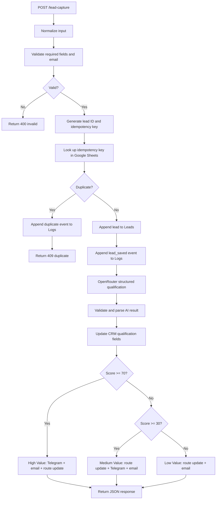

# AI Lead Capture & Qualification

An n8n workflow that receives B2B leads, validates submitted data, checks for duplicate submissions, scores each lead with an LLM, updates a Google Sheets CRM, and routes the lead to the appropriate follow-up path.

> **Portfolio/demo template:** the workflow export in `workflows/` is sanitized. Google Sheets, Gmail, Telegram, and OpenRouter credentials are intentionally not included. Configure your own credentials and resource IDs after importing it.

## Problem

Sales teams receive leads from forms and often need to manually check contact data, decide which requests deserve immediate attention, record results in a CRM, and notify the right people. This workflow automates that first-pass process while keeping the final lead record in a spreadsheet.

## What it does

1. Receives a `POST` request at the `lead-capture` webhook.
2. Normalizes input and validates required fields and email format.
3. Creates a lead ID and deterministic idempotency key.
4. Checks the `Leads` sheet for a prior matching idempotency key.
5. Logs duplicate events to `Logs` and returns HTTP `409` for duplicates.
6. Saves new leads to Google Sheets and records an audit event.
7. Sends lead context to OpenRouter (`openai/gpt-4.1-mini`) with a structured JSON schema.
8. Validates the AI response and writes the score, category, priority, reason, summary, and confidence to the CRM.
9. Routes by score: `>= 70` to High Value, `>= 30` to Medium Value, otherwise Low Value.
10. Sends HTML-formatted Telegram alerts and customer email confirmations on the configured routes, then returns a JSON webhook response.

## Architecture



## Integrations

- **n8n** — workflow orchestration and webhook entry point.
- **Google Sheets** — `Leads` CRM sheet and `Logs` audit sheet.
- **OpenRouter** — LLM-based lead qualification with a JSON schema.
- **Telegram** — internal sales notifications for High and Medium routes.
- **Gmail** — customer acknowledgement emails.

## Google Sheets schema

### `Leads`

Expected columns:

`lead_id`, `created_at`, `updated_at`, `name`, `email`, `company`, `employees`, `service`, `message`, `source`, `status`, `duplicate`, `idempotency_key`, `lead_score`, `category`, `priority`, `ai_reason`, `ai_summary`, `ai_confidence`, `assigned_to`, `route`, `routing_action`, `telegram_sent`, `email_sent`.

### `Logs`

Expected columns:

`timestamp`, `lead_id`, `event`, `status`, `node`, `message`, `email`, `execution_id`, `metadata`.

Create these sheets with the exact header names before running the workflow. The template does not contain a real spreadsheet ID.

## Setup

1. Import `workflows/ai-lead-capture-qualification.json` into your n8n instance.
2. Create credentials in n8n for **Google Sheets OAuth2**, **OpenRouter**, **Telegram**, and **Gmail**. Select them in the corresponding nodes.
3. In all Google Sheets nodes, choose your own spreadsheet and the correct `Leads` or `Logs` sheet.
4. In both Telegram nodes, replace `YOUR_TELEGRAM_CHAT_ID` with the target chat ID.
5. Verify that the OpenRouter credential can call `openai/gpt-4.1-mini`, and confirm that Gmail and Telegram credentials are yours.
6. Keep the workflow inactive while configuring. Run the tests below against the test webhook before activating it.

The webhook test URL for a local instance is typically:

`http://localhost:5678/webhook-test/lead-capture`

For an active workflow, use:

`http://localhost:5678/webhook/lead-capture`

## Example request

```powershell
$body = @{
    name      = "Alex Morgan"
    email     = "alex@example.com"
    company   = "Example Systems"
    employees = 120
    service   = "AI Business Automation"
    message   = "We want to automate lead qualification and sales reporting."
} | ConvertTo-Json -Depth 5

Invoke-RestMethod `
    -Uri "http://localhost:5678/webhook-test/lead-capture" `
    -Method POST `
    -ContentType "application/json" `
    -Body $body
```

The LLM decides the score, so the same test text does not guarantee a particular category. Route boundaries are deterministic after the score is returned.

## Test plan

| Case | Input or action | Expected behavior |
|---|---|---|
| Invalid request | Missing name, company, email, or message | HTTP `400`, status `invalid` |
| Invalid email | Malformed email string | HTTP `400`, status `invalid` |
| New lead | Submit a unique valid lead | New row in `Leads`, AI fields written, route response returned |
| High Value | AI score `>= 70` | Route `high_value`, Telegram alert and email acknowledgement |
| Medium Value | AI score `30–69` | Route `medium_value`, Telegram alert and email acknowledgement |
| Low Value | AI score `< 30` | Route `low_value`, email acknowledgement |
| Duplicate | Submit the exact same email, company, and message twice | Second request returns HTTP `409`; no second CRM lead row; duplicate event logged |

Before testing live email or Telegram nodes, use a mailbox and chat that you control. A successful webhook response should be accompanied by checks of the corresponding Google Sheets rows and the workflow execution details.

## Security and limitations

- The exported workflow contains **no credential secrets**. Use n8n Credentials for tokens and OAuth grants; do not commit `.env` files, API keys, access tokens, private webhook URLs, or real customer data.
- This template replaces the spreadsheet ID and Telegram chat ID with placeholders. They must be configured after import.
- The workflow uses an LLM score as a triage signal, not as a final hiring, credit, legal, or other high-impact decision. Review lead qualification rules before using this in production.
- AI outputs can vary. Treat `lead_score`, `category`, `priority`, and the explanation as machine-generated recommendations.
- Test execution can send real Telegram messages and emails once credentials are connected.

## Repository layout

```text
project-01-lead-automation/
├── README.md
├── LICENSE
├── .gitignore
├── workflows/
│   └── ai-lead-capture-qualification.json
├── docs/
│   ├── architecture.md
│   └── test-cases.md
└── tests/
    └── test-webhook.ps1
```

## Future improvements

- Add retries and error branches for transient API failures.
- Update `telegram_sent` and `email_sent` only after the corresponding send operations succeed.
- Add an automated test harness for route boundaries and duplicate handling.
- Add rate limiting and production webhook authentication.
- Add an explicit human-review/override step for borderline AI scores.
