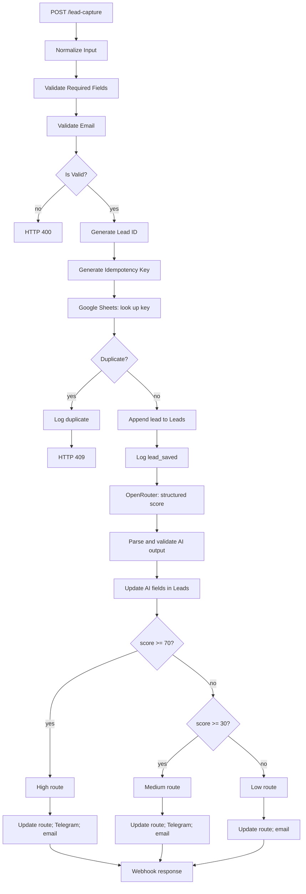

# Architecture and flow

## Data contracts

The request accepts `name`, `email`, `company`, `employees`, `service`, and `message`. `name`, `email`, `company`, and `message` are required by the workflow validation. Input email is trimmed and converted to lowercase.

The OpenRouter request asks for a structured object with:

- `lead_score`: numeric score from 0 to 100
- `category`: `high_value`, `medium_value`, or `low_value`
- `priority`: `urgent`, `high`, `normal`, or `low`
- `reason`: qualification rationale
- `summary`: short summary
- `confidence`: numeric confidence from 0 to 1

The parse node validates score, allowed category/priority values, confidence range, and the presence of reason and summary before writing results to the CRM.
